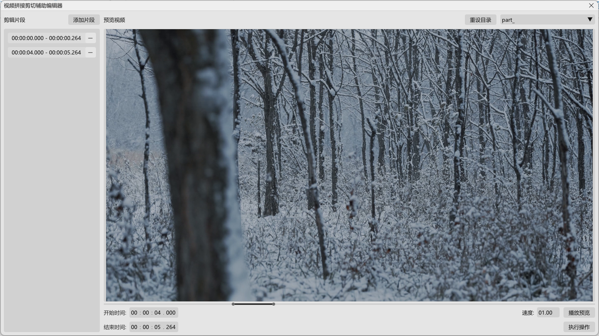
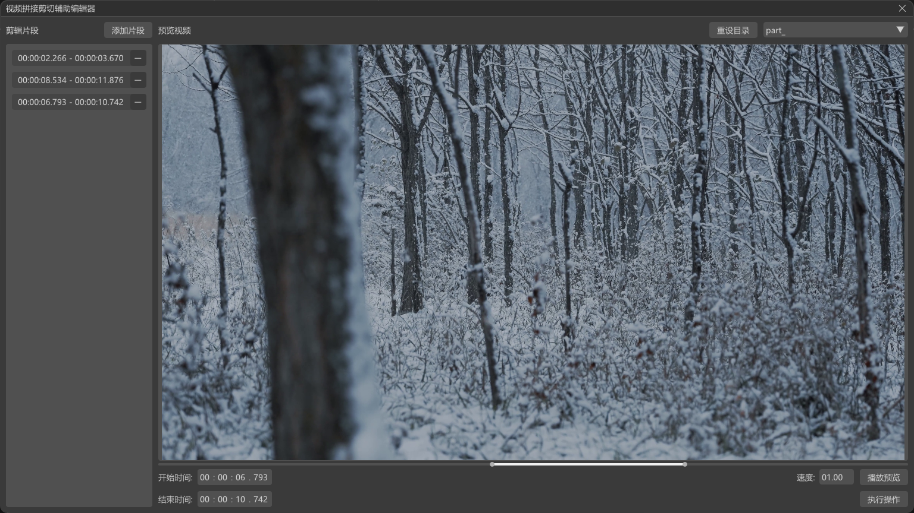

# VideoCut — 视频拼接剪切辅助编辑器

---

一个基于 FFmpeg + Dear ImGui + D3D11 的轻量级视频剪辑工具，支持片段拼接、倍速预览、Intel QSV 硬件加速编码，适合快速预处理批量视频素材。

## 界面主题

亮系主题


暗系主题


> 注:
> - 上述主题在启动应用时根据系统主题自动选择
> - 演示素材来源: [Pexels - Joshua Woroniecki](https://www.pexels.com/zh-cn/@joshuaworoniecki/)

## 特性

- **文件管理**：自动按文件名前缀分组，按末尾数字排序加载；
- **片段剪辑**：通过时间轴滑块或输入框精确选取区间，支持添加/删除剪辑段；
- **倍速预览**：播放速度 1/4× ~ 32× 可调，实时解码显示
- **硬件加速**：支持 `h264_qsv`（需 Intel 核显及驱动支持）
- **声明布局**：基于 JSON 配置布局，自动适配窗口尺寸
- **内存管理**：大部分动态内存通过内存池集中分配管理

## 功能概览

1. **准备界面**：选择视频文件夹 → 自动扫描常见视频格式（`.mpg`, `.mp4`, `.avi`, `.mkv`, `.wmv`, `.ts`）
2. **编辑界面**：
   - 下拉框切换视频分组
   - 时间条 + 滑块精确定位起止点
   - 添加剪辑片段到列表
   - 实时预览（播放/暂停）
   - 设置导出倍速（1/4× ~ 32×）
3. **导出重混**：自动合并重叠片段，输出 MP4 文件

## 目录结构

```
VideoCut/
├── src/                      # 核心源码
│   ├── Application.cpp/h     # 应用程序主控
│   ├── VideoStream.cpp/h     # 视频片段管理与解码
│   ├── VideoEncoder.cpp/h    # 重编码与合并导出
│   ├── StreamPipe.hpp        # 倍速采样管道
│   ├── MediaOrganizer.cpp/h  # 文件分组与内存池组织
│   ├── MediaFileUtils.cpp/h  # 文件系统操作
│   ├── UIEventHandler.cpp/h  # UI 事件绑定与业务逻辑
│   ├── Layout.cpp/h          # 控件布局定义
│   ├── LayoutSolver.cpp/h    # JSON 布局解析
│   ├── Controls.cpp/h        # ImGui 自定义控件
│   ├── D3D11Manager.cpp/h    # D3D11 设备管理（单例）
│   ├── SecureBuffer.cpp/h    # 内存池
│   ├── BasicDesign.cpp/h     # 响应式尺寸与颜色主题
│   ├── main.cpp              # 程序入口
│   └── resource.h            # 资源 ID 定义
├── LayoutConfig.json         # UI 布局描述（必需）
├── Resource.rc               # 资源脚本
├── AppIcon.ico               # 应用程序图标
└── vcpkg.json                # vcpkg 依赖清单

注：
由于 FFmpeg 许可限制，本仓库不提供任何形式的可执行文件、二进制产物。
```

## 依赖库

| 库 | 用途 | 获取方式 |
|---|---|---|
| [FFmpeg](https://ffmpeg.org/) | 视频解码/编码/复用 | vcpkg: `ffmpeg[qsv,x264]` 或自行编译 |
| [Dear ImGui](https://github.com/ocornut/imgui) | 即时模式 GUI | vcpkg: `imgui[dx11-binding,win32-binding]` |
| [RapidJSON](https://rapidjson.org/) | JSON 解析 | vcpkg: `rapidjson` |
| Windows SDK | D3D11, MF, COM | Visual Studio 自带 |

### 关于 FFmpeg 的重要说明

静态链接 FFmpeg 或使用 libx264 解码器将触发 **LGPL/GPL 许可证的传染性条款**，要求**公开应用程序的源代码**并**允许用户重新链接/替换 FFmpeg 组件**。

本仓库已公开完整源代码以满足上述要求。如您计划分发二进制文件请：
1. 确保遵守 FFmpeg 的许可证要求（提供完整源码、构建脚本、允许用户重新链接）
2. 或改用 FFmpeg 的 DLL 动态链接方式或放弃 libx264 解码器（LGPL 允许动态链接而不传染）

**本项目不提供预编译的二进制文件**，需要用户自行构建。

## 构建指南

### 使用 vcpkg + Visual Studio

1. 安装 [vcpkg](https://vcpkg.com/)
2. 在项目根目录创建 `vcpkg.json`（内容参考下方）
3. 在 Visual Studio 中配置：
   - 包含目录：`$(VCPKG_ROOT)\installed\x64-windows-static\include`
   - 库目录：`$(VCPKG_ROOT)\installed\x64-windows-static\lib`
   - FFMPEG 库（如需静态链接）：
      - `avcodec.lib` | 编解码
      - `avformat.lib` | 封装格式
      - `avutil.lib` | 工具函数
      - `swscale.lib` | 像素格式转换
      - `swresample.lib` | 音频重采样
   - Windows 系统库（如不需静态链接 FFMPEG，请忽视后五项）：
     - `d3d11.lib` | Direct3D 11
     - `mfplat.lib` | 媒体基础平台
     - `mfuuid.lib` | 媒体基础 UUID
     - `strmiids.lib` | DirectShow UUID
     - `ws2_32.lib` | Windows Sockets
     - `ncrypt.lib` | 加密 API（NCrypt）
     - `bcrypt.lib` | 加密 API（BCrypt）
     - `secur32.lib` | 安全支持（SSPI）
     - `crypt32.lib` | 加密 API（CryptoAPI）

**参考 `vcpkg.json`：**

```json
{
  "dependencies": [
    {
      "name": "ffmpeg",
      "features": ["qsv", "x264"]
    },
    {
      "name": "imgui",
      "features": ["dx11-binding", "win32-binding"]
    },
    "rapidjson"
  ]
}
```

### 手动构建（不使用 vcpkg）

1. **FFmpeg**：自行编译静态库（参考 [FFmpeg 官方文档](https://trac.ffmpeg.org/wiki/CompilationGuide)），启用 `--enable-static --disable-shared` 和 `--enable-libx264 --enable-qsv`
2. **Dear ImGui**：克隆源码，将 `imgui/` 及 `backends/` 下相关文件添加到项目
3. **RapidJSON**：仅需头文件，添加包含路径

### 编译选项

- C++ 标准：C++20
- 运行时库：（若您计划静态分发）`/MT`（Release）或 `/MTd`（Debug）
- 目标平台：x64

## 使用说明

1. 启动程序，点击「浏览文件夹」选择视频目录
2. 点击「打开文件夹」扫描视频，自动进入编辑器界面
3. 在下拉框中选择视频分组（按文件名前缀分组）
4. 使用时间条或滑块调整剪辑起止点，点击「添加片段」
5. 在片段列表中可删除不需要的条目
6. 设置播放倍速（1/4× ~ 32×），点击「播放预览」查看效果
7. 点击「执行重混」导出合并视频（输出到原目录，文件名加 `[remix]` 后缀）

> **导出耗时**：取决于视频长度和编码设置，Intel QSV 可显著加速，如使用 NVIDIA 须自行在 `VideoEncoder` 中实现 NVIDIA 解码与再编码。

## 已知限制

- 仅支持 Windows 平台（依赖 D3D11、Win32 API）
- 所有导入视频需保持 **相同的分辨率、帧率**（否则加载失败）
- 音频输出格式固定为 AAC 48kHz 立体声
- QSV 硬件加速需要 Intel 核显及正确安装的驱动程序

## 许可证

[MIT License](LICENSE) — 自由使用、修改、分发。

**但请注意**：MIT 许可证仅适用于本仓库的源代码。FFmpeg 的静态链接可能使最终二进制文件受到 LGPL/GPL 约束，请在使用和分发前仔细阅读 [FFmpeg 许可证说明](https://ffmpeg.org/legal.html)。

## 致谢

- [FFmpeg](https://ffmpeg.org/) — 多媒体处理核心
- [Dear ImGui](https://github.com/ocornut/imgui) — 简洁高效的 GUI 库
- [RapidJSON](https://rapidjson.org/) — 快速 JSON 解析
- [Pexels - Joshua Woroniecki](https://www.pexels.com/zh-cn/@joshuaworoniecki/) - 演示素材
